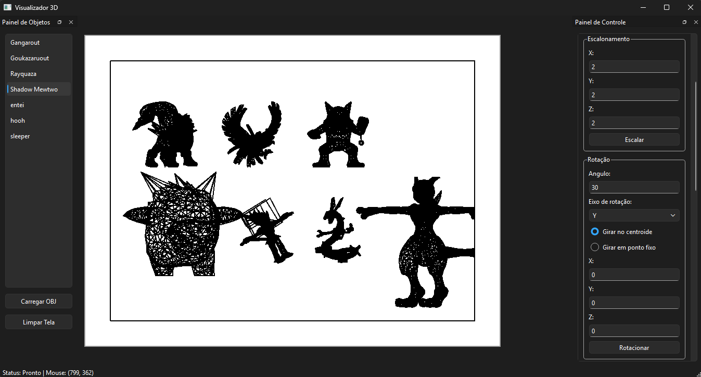

# Visualizador 3D

Trabalho da disciplina de **Computação Gráfica** (Ciência da Computação, UTFPR Ponta Grossa).

Visualizador de modelos 3D em C++ com Qt, com todo o pipeline gráfico implementado à mão: transformações com matrizes homogêneas, projeções, recorte (clipping) e transformação window–viewport. Nenhuma biblioteca gráfica 3D (OpenGL, etc.) é usada para desenhar: o Qt só desenha as linhas finais na tela.

<!-- Adicione um print do programa rodando: salve em docs/print.png e descomente a linha abaixo -->

## Funcionalidades

- **Leitor de arquivos Wavefront (.obj)**: lê vértices (`v`), faces (`f`) e linhas (`l`), aceita índices negativos e o formato `v/vt/vn`, e valida coordenadas e índices com mensagens de erro por linha.
- **Carregamento automático** dos modelos em `assets/models`, organizados em grade e normalizados para a mesma altura; outros `.obj` podem ser abertos pela interface.
- **Transformações geométricas** com matrizes 4×4 em coordenadas homogêneas:
  - translação;
  - escala em torno do centroide do objeto;
  - rotação nos eixos X, Y ou Z em torno do centroide ou de um pivô escolhido.
- **Projeções**: ortogonais frontal (XY), superior (XZ) e lateral (ZY), e projeção em perspectiva.
- **Câmera**: mover para frente, trás e para os lados, e girar a visão (olhar para cima, baixo, esquerda e direita).
- **Recorte 3D** dos segmentos contra o volume de visualização (seis planos, recorte paramétrico), seguido de **recorte 2D com Cohen-Sutherland** contra a window.
- **Window e viewport**: pan e zoom da window, viewport ajustável pela interface e transformação window–viewport com inversão do eixo Y da tela.

## Estrutura

| Arquivo | Papel |
| --- | --- |
| `matriz.h/.cpp` | Matriz 4×4: multiplicação, transformações e projeções |
| `objeto.h/.cpp` | Objeto 3D como lista de faces; centroide e aplicação de transformações |
| `leitorobj.h/.cpp` | Leitor e validador de arquivos `.obj` |
| `meuframe.h/.cpp` | Área de desenho: display file, projeção, clipping 3D e 2D, window–viewport |
| `mainwindow.h/.cpp` | Interface: carregamento de modelos, transformações e controles de câmera |

## Como rodar

Requer Qt 6 (ou Qt 5.15) e um compilador C++17.

1. Clone o repositório.
2. Abra o projeto no **Qt Creator**.
3. Compile e rode. Os modelos de `assets/models` são carregados ao abrir o programa.

## Como usar

1. Selecione um objeto na lista.
2. Preencha os valores e aplique translação, escala ou rotação (na rotação, escolha o eixo e se o pivô é o centroide ou um ponto informado).
3. Troque a projeção no seletor (frontal, superior, lateral ou perspectiva).
4. Use os botões de câmera, pan e zoom para navegar pela cena e ajuste a viewport pelos campos numéricos.
